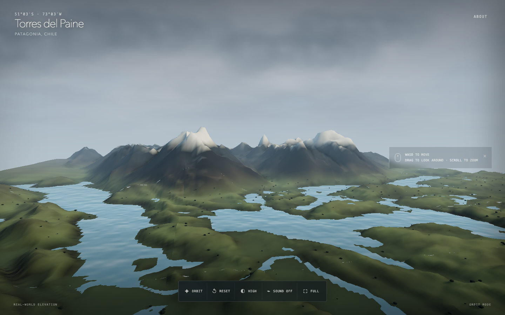

# Torres del Paine — Aerial Explorer

An interactive Three.js flight across Lago Pehoé toward Paine Grande and the Cuernos del Paine. The scene combines real-world elevation and lake geometry with procedural terrain materials, water, cloud cover, snow, vegetation, and cinematic lighting.



## Features

- Real 30 m Copernicus GLO-30 elevation, bundled for offline runtime use
- OpenStreetMap-derived water geometry with per-lake surface leveling
- Three-level tiled terrain LOD and adaptive low, medium, and high quality modes
- Orbit navigation and pointer-lock free flight with terrain-aware clearance
- Procedural terrain shading, animated water, atmospheric fog, clouds, SSAO, bloom, and ACES tone mapping
- Persistent control preferences and automatic performance adjustment
- Reproducible terrain preprocessing plus unit, browser, and visual-regression tests

## Requirements

- Node.js 22 or newer
- npm 10 or newer
- `uv` only when regenerating the geographic assets

## Getting started

```bash
npm install
npm run dev
```

Open [http://127.0.0.1:4173](http://127.0.0.1:4173).

## Controls

| Mode | Input | Action |
| --- | --- | --- |
| Orbit | `WASD` or arrow keys | Move across the landscape |
| Orbit | Drag | Rotate around the landscape |
| Orbit | Scroll | Change camera distance |
| Fly | Click the landscape | Capture the pointer |
| Fly | `WASD` or arrow keys | Move horizontally |
| Fly | `Space` / `C` | Move up / down |
| Fly | `Shift` | Sprint |
| Fly | `+` / `-` | Adjust flight speed |
| Fly | `Esc` | Release the pointer |

## Commands

- `npm run dev` — local development server
- `npm run build` — type-check and production build
- `npm run preview` — preview the production build
- `npm test` — unit tests
- `npm run test:e2e` — browser tests and visual regression
- `npm run terrain:build` — regenerate local terrain assets

## Architecture

- `src/terrain-data.ts` loads and samples the shared elevation and lake-mask grids.
- `src/terrain.ts` builds the patch LODs, biome colors, vegetation, and flattened water geometry.
- `src/navigation.ts` provides orbit/free-flight controls and terrain-aware camera constraints.
- `src/shaders.ts` contains the procedural sky, cloud, and animated water shaders.
- `scripts/build_terrain.py` regenerates the geographic runtime assets.

## Terrain asset pipeline

The checked-in runtime assets in `public/data/` are generated by `scripts/build_terrain.py`. The script uses `uv` to provide Rasterio, NumPy, and Shapely, reads four Cloud Optimized GeoTIFF tiles from the public Copernicus DEM GLO-30 bucket, crops them to `-73.28, -51.20, -72.82, -50.88`, resamples to a 513 × 513 little-endian `uint16` heightfield, and rasterizes OpenStreetMap water polygons into a matching mask.

Regeneration requires network access:

```bash
npm run terrain:build
```

The browser makes no terrain, map, font, analytics, or API requests at runtime. The generated assets are committed under `public/data/`, so the app works as a static deployment.

## Testing

```bash
npm test
npm run test:e2e
npm run build
```

The Playwright suite covers loading, navigation mode switching, camera reset, quality persistence, responsive resizing, attribution, same-origin runtime isolation, and two desktop visual-regression viewpoints.

## Attribution

Produced using Copernicus WorldDEM-30 © DLR e.V. 2010–2014 and © Airbus Defence and Space GmbH 2014–2018, provided under COPERNICUS by the European Union and ESA; all rights reserved.

Water geography © OpenStreetMap contributors, available under the Open Database License.

The reference photograph is used only as visual direction and is not distributed with the project.
